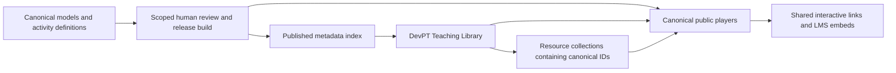

# DevPT public teaching library plan

Prepared 20 October 2026. Status: production release preparation following the owner’s explicit request to commit, open PRs and merge live. The source-owned publication policy admits bounded resource illustrations; it does not assign clinical or faculty acceptance. Experimental physics remains local-only. Actual deployed revisions are recorded in the release PRs and deployment checks.

DevPT offers a faculty-facing **Teaching Library** alongside its product pages: browse by region or topic, open a ready-made collection, explore an interactive resource, save useful resources together, and share one collection link or copy every resource link. This implementation contains resource collections only. A structured lesson builder is an optional later extension, outside the current scope.

The library uses the same models, teaching content and players as their owning products. DevPT owns discovery and resource selection; the owning product owns the activity. A local review build can expose candidates for inspection without making them approved public content. The first public release remains constrained by demonstrated readiness, rather than a target number of assets.

## Publication scope for this release

The owner’s live-release request authorizes publishing selected resource experiences, independently of the clinical review records that remain pending. SimLab owns the explicit `publication-policy.json` and derives `/teaching/catalog.json` from the same canonical catalog. Public entry lookup enforces that policy, not just the website cards. The bounded entry locks the selected hip presets, suppresses neighboring unreviewed laboratory controls, and preserves supported viewing, layers, native playback and reference guidance. Public Gait Lab excludes ROM mutation, Practice and physics; it does not claim validated pathological gait or predicted compensation. Live Vitals and Neuro remain outside the public selection.

DevPT consumes `https://lab.devpt.app/teaching/catalog.json` directly. It never falls back to the local candidate catalog. Product previews and contact remain usable during a catalog outage. Source-owned resources launch only on user action and pause/dispose when left. Website deployment waits for the published catalog, entry marker and trusted framing before it uploads an explicit static export. Development servers, simulation runners, docs, caches and generated product copies are excluded from that export.

The EMR shared rail and PACS exact DevPT parent support deploy from their owning repositories before the hub depends on them. Existing required checks remain merge conditions. Owner publication authorization is not recorded as faculty clinical review; remaining model limitations and the experimental physics failure remain visible in source records.

## Decisions to adopt

1. Lead with ready-made **collections**, with overlapping **Regions**, **Topics**, and **All resources** browse views. Examples include All Things Hip, All Things ROM, Biomechanics, Manual Therapy, Gait, and Eyes & Vestibular. Each refers to the same canonical resource IDs.
2. Support **Save resource**, **Save all**, a resource-only saved collection, one-link collection sharing, and bulk copying of resource links. No lesson authoring, custom teaching prompts, graded sequence, or lesson service is part of this rebuild.
3. Keep source assets, model derivatives, clinical content and players in their existing homes. Generate local delivery artifacts from those sources; never edit website copies.
4. Require no account for local browsing, opening resources, saving in the current browser, or sharing resource lists. Cross-device ownership and server persistence remain future capabilities.
5. Keep public publication approval separate from ordinary development and engine merge rules. Release bounded activities and approved configurations; approval of one hip demonstration must not expose an unfinished neighboring lab.
6. Build the EMR preview rail in the EMR source using shared navigation presentation and safe practice actions, then integrate that real source build into the local DevPT site.

## Full local DevPT rebuild

The site entry is the root `index.html`, with `teaching-library.js` and `teaching-library.css` providing the resource interface. Product pages, live product previews, contact information and the existing legal/information pages remain part of the full site. The build is no longer a separate design-preview destination.

The resource metadata authority is SimLab's `apps/mission-shell/src/lib/teaching/catalog.json`. Its current 12 candidate IDs are `hip-anatomy`, `hip-rotation`, `hip-flexion`, `hip-biomechanics`, `hip-manual-therapy`, `gait`, `canal-mechanics`, `bppv-examination`, `eye-responses`, `live-vitals`, `neural-pathways`, and `sectional-anatomy`. DevPT's prepared collections reference these IDs; they do not duplicate model paths, clinical parameters or resource explanations. An absent or invalid source catalog must produce an unavailable state rather than a substitute catalog.

The source-owned SimLab teaching entry imports the existing JointLab, MovementLab, VestibularLab, EyeLab, Live Vitals and NeuroLab components, plus GaitLab. simPACS remains its canonical anatomy/imaging viewer. The EMR preview is built from the actual EMR public workspace and source-owned navigation adapter. It is not a website-side imitation of the note writer or navigation rail. These local entries do not change the ordinary deployed product entrypoints.

The local catalog is explicitly `local-development-only`. It includes candidates and unfinished material for review; inclusion in a prepared collection does not clear an asset for public launch. The site must preserve a concise local/nonpublic indicator and keep review details available without cluttering the faculty browse flow.

The root local pipeline is organized around `scripts/build-local-site.mjs`, `scripts/serve-local-site.mjs`, and `scripts/package-local-site.mjs`. The build consumes source catalogs and generated application builds; the server serves the assembled full site; packaging produces a portable local review artifact. Generated native, simPACS and EMR output must be disposable, carry source/output identity and original credits, and be rebuilt from canonical sources. Do not edit these generated outputs or treat the package as another asset repository. A local share link works only for recipients who can reach the served site; packaging does not create public hosting.

The main page uses visual cards, short titles, resource counts and compact actions. Regions, topics and prepared collections require no account. **Saved resources** stores only valid resource IDs in this browser. Its share link carries those IDs so another reachable browser can open the same resource list without the author's local storage. Clearing local saved resources does not revoke a previously copied list URL. There is no hosted account, editable published lesson, assessment record or private course-data service implied by this local package.

The GaitLab uses packaged **CC native walking clips**. The original blank male teaching model is the default; the original female model and source characters are selectable. Own-target motion derivatives are generated in SimLab through its existing world-delta/bind-pose retarget pipeline, with source and target hashes, unchanged sample times and proportion tests. They are not hand-authored replacement gait patterns. The native clip registry and deterministic generator select the same clips. Rebuild/check the derivatives whenever the source rig, motion, target rig or selected clips change.

Learners mark two same-foot contacts to establish a cycle, then use a conventional phase guide, measured source motion and practice questions inside the source-owned gait resource. These are resource interactions, not a DevPT lesson-authoring feature. Phase percentages are reference guidance, not verified source event detection. ROM studies edit selected native joint channels on a copy while preserving root travel; they do not synthesize physiological compensation. Edits that exceed the existing foot/floor allowance retain the original motion. No packaged native pathological gait clips were identified in the current source libraries; clinical impairment presets remain a separate acquisition and review task. Do not substitute procedural patterns while labeling them native CC gait.

The ROM resource now exposes hip, knee and ankle/foot line charts in sagittal, frontal and transverse planes. Original and accepted edited traces share the native time window and per-channel axes. Approximate phase bands appear only after a same-foot contact interval is marked; an unmarked full take uses native seconds. Missing measurements remain gaps. Knee secondary-axis signs remain provisional, and foot-relative-leg rotation is not foot progression.

Separate **Simulation** and **Reference** views distinguish physics estimates from teaching illustrations. The local launcher invokes a generated build of the canonical simMOVE MuJoCo runner, using the exact selected source recording, calibrated transform, native free-root ancestor channels and source-bound teaching-body fixture. Force vectors come from native contact reactions. Regional mean pressure divides each collider group's actual normal load by its nominal projected model area; it is a coarse engineering estimate, not measured peak plantar pressure. References remain explicitly illustrative and never replace a failed simulation result.

A computed trial is not automatically a suitable representation of the animated walk. The source-owned physics report retains native stops, source tracking errors, mass, coordinates, contact assumptions and qualification fields. The first stationary-floor trials expose the mismatch between in-place CC walking and overground mechanics. The local runner now offers explicit stationary-floor and velocity-actuated moving-belt conditions; belt speed is an inspectable assumption. Both initial conditions still expose unqualified source tracking, so a dedicated alternating-support walking controller remains necessary for qualified gait-force results. Incomplete or poorly tracked trials must remain experimental in the local review and cannot enter the polished public library. This adds a resource implementation capability, not a lesson builder or public approval.

## What exists and what can launch

The audit covered the local DevPT homepage, SimLab, EMR and PainMap sources, plus selected simPACS source files accessed through GitHub. It establishes implementation and documented review status. A fresh visual acceptance review of every candidate remains part of publication.

**No newly audited teaching activity can responsibly be labeled fully verified from the available records alone.** Several excellent candidates exist, but movement educational review, joint clinical content and vestibular clinical sign-off are explicitly pending or unrecorded. Existing public exposure does not establish acceptance. A reviewer can approve a narrow teaching purpose without endorsing an entire simulator, every movement, or clinical measurement validity.

| Asset family | What is already implemented | Best first public slice | Current publication decision |
| --- | --- | --- | --- |
| Patient ROM demonstrations | Native MovementLab and authored presets, shared patient/pose engine, observation and playback behavior | Review `capsular-hip` and `painful-hip-flexion` first; consider `knee-contracture` next | Strong candidates, not cleared. Educational review remains pending; review exact movement, supports, visible response and explanatory wording |
| Regional 3D anatomy at rest | Fifteen regional modules with native geometry, structure selection, focus/isolate/hide/reset | One reviewed region at rest with useful labels and an explicit structure set | High-priority candidate. Rest anatomy has a narrower validation burden than dynamic biomechanics; confirm anatomy, labels, cut boundaries and rights |
| Whole-body and regional anatomy through simPACS | Existing canonical `/embed` viewer, regional framing, both sides, labeling and attribution | One reviewed regional orientation/isolation activity | Candidate. simPACS remains its home; no named faculty acceptance discovered in inspected source |
| Vestibular mechanism explorer | Six interactive demonstrations, phase navigation, playback/scrubbing, healthy comparison, keyboard camera controls | Normal versus posterior-canal mechanism, each reviewed as a bounded activity | Strong candidate. Documentation explicitly records no clinical sign-off; 27 targeted implementation tests passed during this audit |
| Posterior-canal BPPV examination illustration | Existing EyeExamFigure and native public BppvSample | The existing right posterior-canal BPPV / Dix–Hallpike teaching sample | Strong narrow candidate. Review exact side, setup, response and explanation; do not imply it is a finding from the James case |
| Synthetic sectional anatomy and imaging | simPACS slicing and CT/MRI/X-ray/US-style educational appearance | One reviewed non-spinal synthetic anatomy/imaging activity | Conditional candidate. Clearly identify synthetic imagery and artist-tuned approximations; preserve source restrictions |
| Joint mechanics and manual therapy | Fifteen modules and 406 presets, extensive engineering/source records | A specific future reviewed demonstration, after rest anatomy | Hold the broad library. Authored clinical content is explicitly unreviewed; contact, support and model assumptions need scoped review |
| Dynamic muscle studies, reference excursions and morphology | Specialized source geometry, motion and teaching overlays | Separate later releases | Hold. Existing source records retain pending review and distinguish modeled excursion from biological maximum ROM |
| Native walking and gait exploration | Source-owned GaitLab, packaged CC walking clips, reviewed engineering receipts and constrained ROM studies | A bounded native-walk observation activity after content and rights review | Local development candidate. Retarget/playback checks do not establish gait-event accuracy, pathological-gait validity or faculty acceptance |
| Neural pathways, live vitals and other labs | Existing shared lab implementations and public study-tool entries | Evaluate individual teaching tasks later | Not established as launch-ready by this audit. Give each its own evidence record rather than inheriting approval from a neighboring activity |
| Aquatic demonstrations | Existing native aquatic lab and shared engine integration | None in the first release | Hold. Recorded movement audit identifies unresolved ROM enforcement, coordinate/frame and unit issues |

The proposed first review queue is intentionally small: regional anatomy at rest; the two hip ROM presets; posterior-canal vestibular mechanics; its corresponding BPPV examination illustration; and one synthetic imaging activity. Publish whichever pass all gates first. Do not add filler to make every category look populated.

SimLab registers four Git submodules: `pose-engine`, `scenario-engine`, `apps/painmap` and `apps/simvitals`. They are dependency/source boundaries, not pre-approved public teaching packages. The branching scenario engine supplies behavior rather than a freestanding faculty asset. simPACS is an external canonical application, not a SimLab submodule. Keep this distinction visible in the engineering inventory while presenting activities by learning purpose to faculty.

The ROM preset values are authored scenario settings, not normative claims: `capsular-hip` uses right supine PROM internal rotation at 10°, and `painful-hip-flexion` uses right active hip flexion at 90°. Their existing wording includes pain and end-feel concepts. A public release must distinguish what is visually modeled from what is supplied as an authored finding. A browser animation cannot itself establish tactile end-feel or a diagnosis.

### Existing public surface needs a narrower boundary

SimLab's current public StudyView opens entire JointLab, FullBodyLab, NeuroLab, MovementLab, EyeLab, VestibularLab, AquaticLab and LiveVitalsLab components. Those components expose more than a reviewed asset card would imply.

Before promoting the new library, replace broad public study-tool access with an allowlist enforced by the owning public entry. Check asset ID, release, preset, parameter ranges, overlays, neighboring links and all reachable selectors. Unknown IDs and unsupported state must fail closed. A filtered card list alone is insufficient.

The same publication rule should apply to the current public study-tool explorer. Keep the live product tour and its curated practice workflows, while ensuring its study links resolve only to released activities. Do not advertise an unreviewed lab through an alternate old URL.

## Faculty discovery and navigation

### Options considered

| Organization | Strength | Limitation | Role |
| --- | --- | --- | --- |
| Body region first | Familiar for MSK anatomy and ROM courses | Awkward for vestibular systems, imaging principles and cross-topic lessons | A strong filter and secondary browse view |
| Discipline or course first | Matches faculty preparation tasks | Course names vary; many assets belong in several courses | Curated teaching collections and suggested uses |
| Product or media type first | Maps to existing applications and implementation | Faculty must translate product names and formats into learning needs | Product marketing and optional activity-type filter |
| Regions and topics with prepared resource collections | Supports familiar anatomy browsing and cross-topic teaching needs | Requires consistent metadata | Implemented browse structure |

The rebuilt navigation is **Regions · Topics · All resources · Products · Contact**, with a visible **Saved** resource count and a secondary For faculty destination. Prepared collections can appear under both region and topic views without duplicating their resources. Product pages continue to present simLAB, EMRs and 3Dpain.app.

The local interface uses hash routes such as `#/regions`, `#/topics`, `#/library`, `#/collection/all-hip`, `#/activity/hip-anatomy`, and `#/saved`. Clean canonical public URLs can follow when the public hosting and release contract are ready; do not describe them as deployed endpoints now.

The homepage leads with region/topic browsing and ready-made collections, then offers the broader products. Search and compact filters provide a direct route to individual resources. Load posters and metadata initially; activate a simulator only after the visitor opens a resource. Public deployment must filter these same views to released activities and omit empty collections.

Search should understand public titles, anatomical terms, synonyms and reviewed learning objectives. Facets should include body region/system, topic, activity type, learner level, approximate teaching time and teaching setting. Show useful access information such as keyboard controls or a text alternative. Keep a modest initial filter set and add facets when inventory warrants them. Avoid displaying empty categories or technical submodule names.

Every activity page should answer:

- What can students learn here? State one concrete outcome.
- What will they do? Show the actual interactive player and a short suggested task.
- Where might I use it? Include a suggested course context, learner level, prerequisites and approximate time.
- What does this model cover? Explain relevant modeled scope and limitations near the activity.
- Can I trust and reuse it? Provide references, review scope/date, version, attribution and permitted reuse.
- How do I teach with it? Provide **Open full view**, **Share**, and **Save resource**.

Use public, generic learning outcomes. SimLab's curriculum package includes private institutional course objectives; do not publish that catalog or its identifiers automatically. CAPTE mapping, if included later, must be accurate, scoped and rights-cleared rather than implying program accreditation or validated educational effectiveness.

## One source for every asset

### Ownership

| Home | Owns | Public site's responsibility |
| --- | --- | --- |
| SimLab | ROM, joint, eye and vestibular teaching definitions, native UI and activity behavior | Discover and launch the released activity; do not recreate controls |
| pose-engine | Matched mannequin runtime GLBs, rig and movement engine | Reference the owning release and dependency hashes |
| vspx-3d-assets | Upstream heavy mannequin source and bake pipeline, as described by the runtime copy script | No new direct runtime dependency or parallel model library |
| simPACS | Anatomy atlas, regional definitions, anatomy/imaging viewer, synthetic imaging and source attribution | Use its canonical released viewer and public contract |
| EMR platform | Note writer, navigation, schedule, feedback and synthetic practice data | Frame source-owned public samples |
| devpt-home | Public marketing, discovery presentation, navigation and links | Consume the published index and compose faculty journeys |
| DevPT resource collections | Prepared collection membership and browser-saved resource selections | Store canonical resource IDs; never copied models or activity definitions |

The homepage registry currently calls vspx-3d-assets an intended unconsumed runtime authority. The existing PainMap copy script is more precise: pose-engine is runtime truth and vspx-3d-assets is upstream source/bake storage. Reconcile this documentation and record the actual chain before release; a wholesale asset migration is not required to build the library.

Source-generated deployment copies and CDN objects are acceptable delivery artifacts. They must be immutable or verifiably associated with their release and regenerated from the owning source. They must never become separately edited master files. Existing historical `demos/native-joints` content and copied preview bundles must not become the new library's foundation.

### Source-owned publication records

Extend the existing SimLab teaching catalog with the public publication contract. Its current development status is not a release approval. Each source owns its asset definitions and approval evidence. A composition index references those definitions; it must not hand-maintain another copy of model paths, labels, controls or clinical parameters in devpt-home.

Each candidate needs: stable asset ID; owner; concrete outcome; title and search terms; source entry/preset; supported configuration schema; review scope and reviewer/date; source and dependency digests; model provenance and rights; accessibility behavior; performance budget; public player entry; version; and lifecycle status. Internal review details remain private; expose only the public review summary needed by faculty.

Use lifecycle states such as **draft → review → approved → published → deprecated/withdrawn**. Approval is bound to the declared purpose, dependency set and allowed configurations. Only a named authorized human records content acceptance. Automation checks that a valid record exists and applies to the artifact; it does not assign clinical verification.

For public release, the build must generate a read-only catalog projection containing only published records. Serve it from the owning release system and use it to generate searchable activity pages and discovery metadata. devpt-home may cache the projection, with build identity and bounded cache lifetime; it may not invent unpublished records. Public players must revalidate eligibility, including withdrawal, so a stale index cannot expose a retired asset.

Suggested API concepts and routes are proposals, not existing endpoints: a published catalog, a stable activity landing page, and a dedicated public-player URL for each released activity. Keep all player construction in its owning application.

### Releases and no drift

A stable generic activity link follows the current approved release. Development changes are never automatically promoted by a marketing deploy. SimLab and the public player resolve the same activity definition and matched runtime for the same release. CI compares the model/data/configuration digests and exercises that same preset in both hosts.

Shared resource lists resolve canonical IDs through the current catalog; they do not contain copied models or a frozen source snapshot. For public publication, generic resource links should follow compatible approved updates while preserving supported settings. Display the current release and change information. Instructional breaking changes require a new activity identity or an explicit review-needed state, rather than silently turning an old link into a different demonstration.

Optional semester-frozen collections can later reference retained immutable releases generated by the same pipeline. This is an explicit version choice, never an independently edited library or a source snapshot vendored into the homepage. Do not promise frozen versions until model **and player runtime** retention, compatible state, storage cost and support duration are implemented. A withdrawal for a serious content or rights problem overrides either link mode.

For a changed configuration, migrate validated state explicitly or show a replacement prompt. Never silently switch to the first preset, opposite side or an unrelated activity. A source service outage should produce an honest retry/full-view alternative, not a stale video presented as live interactivity.

## Interactive sharing

### Share an activity or its current view

Give each released activity a permanent, human-readable landing URL. A Share action offers a normal link, QR code and responsive embed snippet, with a copyable title/citation. Separate **Share activity** from **Share this view** so a faculty member chooses between the standard starting point and their configured demonstration.

“Share this view” needs a versioned state schema owned by the player. Depending on the activity, that can include approved preset, region, side, selected structures, labels, camera orientation, supported layer visibility, slice orientation/position, playback position, comparison mode and speed. Do not assume every player supports every field. Preserve only state that can be restored accurately and remains within the approved scope.

Current sharing is incomplete: MovementLab does not restore an arbitrary body preset from its URL; JointLab preserves some joint/muscle/source modes but not all camera, layer, side or timing state; vestibular and simPACS need a broader saved-view contract. Extend these native players rather than building a second renderer.

Validate every shared field and version. Bound numeric ranges, identifiers and payload size; reject unknown combinations and executable/HTML content. Use short IDs for large saved views; small self-contained state may use an encoded URL fragment. Do not put patient, learner, private course or credential information in a public URL. A copied view must open correctly in a clean browser without the author's local storage. The current resource interface shares a resource's standard entry or a list of resource IDs; arbitrary saved-view restoration and responsive embed-code generation remain additions to the player contract, not implied current capabilities.

### Branding and reuse

Place a restrained **devpt.app** attribution link inside the source-owned public player so it remains visible in embeds and fullscreen. Add it to exported screenshots when permitted. Keep source/license credits accessible separately; a DevPT watermark cannot replace attribution.

simPACS and regional anatomy derivatives retain AnatomyTool/LUMC, Z-Anatomy and BodyParts3D lineage and CC BY-SA 4.0 obligations. Review redistribution and derivative requirements for the actual public delivery path, including downloadable exports. Original vestibular organ geometry also uses a shared mannequin head dependency, which needs its own rights record. Do not infer rights from a repository being accessible.

The watermark supports attribution and discovery. Interactive browser delivery sends data to the browser and cannot guarantee that models are unextractable. Publish only assets whose rights support the intended delivery.

### Web delivery and accessibility

Retain the specialized existing players. GLB/glTF and supported optimized derivatives are sensible web delivery formats, but adopting a separate generic viewer for existing simulations could lose reviewed behavior and introduce maintenance drift. Generate compression, texture and level-of-detail derivatives through the canonical build, then verify labels, landmarks and motion still match.

Use lightweight posters for browsing and a single active 3D resource on the current resource page. Release inactive contexts and pause animation when hidden; reuse SimLab's existing visibility and renderer-lifecycle work. Test restoration after hiding, device rotation, fullscreen and WebGL context loss. Show truthful progress, retry and full-view actions on failure.

Provide named views, visible zoom/rotation controls, keyboard operation, reset, pause and scrub where applicable. Do not require dragging or pinch gestures to perform an essential task. Respect reduced motion and focus order. Provide a meaningful text/diagram teaching alternative; a canvas label alone is not equivalent access. State any activity whose learning purpose depends on visual-spatial inspection so faculty can plan an appropriate alternative.

Measure time to usable interaction, memory and rendering behavior for the exact asset on supported desktop and mobile devices. Establish a per-asset launch budget against a documented device/network profile before promotion. The James patient walkthrough's startup cost must not become the default cost of a lightweight anatomy card.

### Embedding and LMS support

Start with universal direct links and tested responsive iframes. Keep a visible Open full view link for systems that strip iframes. Require no third-party sign-in cookies for student viewing. Keep paid/authenticated applications' framing rules unchanged.

Existing SimLab public framing permits DevPT origins; simPACS's bridge defaults to the SimLab origin. Directly hosting simPACS in DevPT therefore requires an explicit trusted-parent addition. Use exact origin and source-window checks, versioned schemas and exact postMessage target origins. Never accept arbitrary model URLs or privileged commands from embed parents.

An LMS iframe containing DevPT which in turn embeds SimLab or simPACS creates an **ancestor chain**. Each child CSP must permit all relevant ancestors; allowing only DevPT is not enough. First support a tested set of institution/LMS hosts on dedicated public embed routes. Unsupported hosts receive the direct-link alternative. A later broadly embeddable public-only route needs an explicit framing policy and a minimal parent interface; it must not widen authenticated-app access or trust arbitrary LMS messages. Test the whole nested chain, each parent's `frame-src` and permissions policy, sandbox permissions and fullscreen delegation before claiming compatibility. The bridge trusts its immediate approved parent window and origin, independently of the broader framing policy.

Do not build roster, gradebook or SCORM packages for the first release. Add LTI 1.3 Deep Linking when demand warrants selecting resources from inside an LMS. It can return multiple selected items when supported by the platform. Add Assignment and Grade Services only when there is a real graded workflow. Use H5P's share/embed flow as a usability reference rather than exporting a separate collection of editable model packages.

## Resource collections and bulk sharing

Prepared collections provide the first useful teaching organization. Faculty open All Things Hip, All Things ROM or another collection, launch any resource, share the collection, copy its individual links, or save all its resources. Collections overlap through IDs rather than duplicated content.

Faculty can also use **Save resource** on any card. The saved-resource tray and Saved page keep the chosen resources together in the current browser. Faculty can remove resources, clear the local selection, copy all links, or share one resource-list URL. A recipient sees the referenced resource cards and can save that list in their own browser. The list contains resources only: no custom prompts, teaching sequence, authored objectives, scoring or completion claims.

The initial saved collection uses local storage, with no account or server-backed ownership. Its share URL contains validated resource IDs, not private text or model data. Localhost links are usable only where that local server is reachable. A browser-local clear action changes the author's saved selection; it does not revoke a copied self-contained list. A future hosted personal collection service would need explicit ownership, access, deletion and revocation semantics before those capabilities are promised.

Opening a resource must resolve its current allowed source entry. Missing, withdrawn or unsupported IDs show an unavailable state. Do not silently replace them with another activity, and do not preserve a forbidden model inside a collection artifact.

### Optional later: structured interactive lessons

A lesson builder is deferred and must not appear as a current workflow or requirement for using the library. If faculty demand it later, add ordered activity references, optional introductions/prompts and a learner preview as a separate feature. Store references and instructional overlays rather than models or renderers. A lesson draft should not modify a shared published revision automatically.

Before adding hosted lesson publishing, define ownership, visibility, version-change notices, text sanitization, size/rate limits, exclusion of private patient/student information, unpublish/revocation, and reporting. Keep faculty-authored prompts distinct from DevPT-reviewed resource content. Scoring, learner records, LTI grade services, and public lesson-directory moderation are further independent decisions. None is needed to browse or bulk-share the resource library now.

## EMR preview side navigation

At the initial audit, the homepage opened the source-owned EMR route `https://simemr.devpt.app/showcase/?presentation=workspace&section=documentation`. Public Workspace mounted the real OrientationWriter without the authenticated SvelteKit layout. OrientationWriter mounted ChartRail but hid its boundary with `display: none`; production navigation lived in AppNavigationRail inside the authenticated layout. The original preview consequently received neither rail.

The local rebuild integrates the real EMR source build with a public-practice adapter in the EMR repository, sharing the production rail's visual presentation, active states, icons, focus behavior and responsive treatment. Separate destinations/actions from presentation so the public entry can use safe local practice actions without importing authenticated routing or workspace prefetching.

- Show the supported public destinations: Note workspace, Student schedule and Faculty feedback. Selecting them uses the existing in-memory sample switch.
- Within the note sample, reuse chart definitions and working local Note Guide/section actions. Omit empty or unsupported destinations unless their sample purpose is useful and clearly identified.
- Preserve the synthetic fixture, reset behavior, memory-only note state, modal focus handling and strict bridge/CSP. On phones, use an accessible compact navigation control without squeezing the editor.
- Do not mount the authenticated layout or recreate the rail in devpt-home. Merely removing the old CSS hiding rule would restore an older chart rail rather than the consolidated navigation the user expects.

Acceptance includes visible desktop navigation, usable phone navigation, all three public sections, working Note Guide jumps, state retention while switching samples, reset/reload behavior and correct Escape/focus handling. Verify no protected API/auth/workspace prefetches and no learner/patient persistence. Extend the existing EMR public-workspace/build/rail tests and the homepage iframe dialog test. Deploy the compatible EMR public entry before any dependent homepage change.

## Publication quality and operations

Publication gates apply to the released educational activity, not to unrelated engine development or merge authority.

| Gate | Required evidence | Responsible role |
| --- | --- | --- |
| Teaching purpose | Concrete outcome, correct terminology, prerequisites, modeled scope and an exact configuration list | Named subject faculty reviewer |
| Content acceptance | Reviewed anatomy/motion/response/explanation and relevant clinical claims for that scope; date and dependency identity | Named authorized content reviewer |
| Provenance and reuse | Source lineage, licenses, required attribution, public web/derivative permission and data provenance | Asset owner with rights review as needed |
| Interaction and polish | Complete load-to-reset flow, accurate state restoration, no broken controls, layouts or unhandled errors | Product/design and engineering owners |
| Access and compatibility | Keyboard and focus flow, motion controls, meaningful alternative, supported phone/desktop and tested LMS framing | Accessibility/QA owner |
| Shared-source integrity | Same matched data/rig/runtime/configuration in source and public host; no forked public model or renderer | Source maintainer |
| Release safety | Unknown IDs/configurations blocked, approved index only, cache/revocation behavior, no protected records or APIs | Release maintainer |

Create a review packet for each candidate with exact starting state, short review tasks, sources, known limitations and reproducible screenshots/interactive link. Review every reachable control state or constrain it. Test controls meaningfully: play/seek/reset agreement, actual rendered anatomy/eye response, correct labels/side, saved-view round trip and clean-browser resource-list sharing. A “playing” badge or successful network status alone is insufficient.

Keep model-dependent review tied to dependency digests so an unrelated documentation change does not trigger complete re-review. Changes to geometry, anatomy labels, motion, clinical explanations, derived imaging, approved control ranges or rights require impact review before public promotion. Renderer changes need dependent activity regression checks; a change that alters educational output requires renewed scoped acceptance. Copy/layout-only changes can follow the normal product review path when they do not alter meaning.

Use automatic checks for schema validity, missing attribution, broken canonical references, source/public parity, saved-state compatibility and unknown-ID rejection. Reuse existing targeted tests rather than making a duplicate public test suite for every internal function. Add browser smoke coverage for representative released activities and the shared player contract. Never change existing clinical verification flags or relax movement thresholds to make publication pass.

Operate the library with a named source maintainer and content steward. Review release health after every source deployment; review broken links/player errors regularly; audit source and license records and underused assets quarterly. Re-review content on material change or a recorded review-due date. These are proposed operational practices, not newly scheduled automations.

Maintain a visible report-an-issue action with asset/release context. A serious incorrect-label, motion, rights or data issue triggers withdrawal of the affected release. Remove it from discovery and block old direct/player/collection links through the same release-status check. Show an explanation and reviewed replacement where possible; do not silently substitute a different resource. Keep prior nonwithdrawn artifacts for the declared support period and test rollback.

## Delivery, public release and expansion

### Current delivery: complete local site

Deliver the root DevPT resource interface and existing product/information pages, generated SimLab catalog and native teaching build, canonical simPACS viewer, and real EMR public workspace with its safe navigation rail. Use the root build/server/package scripts for a reproducible full-site review. Preserve source identity and credits in generated delivery output.

Acceptance includes region/topic/prepared-collection browsing, searchable resources, native player launch and full view, source-owned product previews, working EMR navigation and reset, browser-local saving, save-all, one-link resource-list sharing, bulk copy, and usable phone layouts. A clean browser receiving a shared list must see the same valid IDs. Broken source builds must fail honestly; do not substitute website-side models or mock EMR screens. No lesson builder is part of acceptance.

### Public release preparation

Complete the ownership record, per-candidate review packets, publication/state schemas and exact configuration boundaries. Correct the broad public study-tool entry so unfinished neighboring tools cannot bypass those boundaries. Existing engineering checks and a successful local review package do not grant public approval.

Publish only the explicit owner-authorized scope, with rights evidence and the required interaction/accessibility/performance checks. Keep clinical and faculty review statuses separate and truthful. An additional or broader activity requires a new explicit publication decision; a generic catalog addition must not publish it automatically. Generate the public catalog from eligible source records and exclude unreleased content from all cards, collections, direct players and legacy routes. Verify live dependency deployment and supported host framing before replacing public links.

### Expansion from demonstrated demand

Add reviewed resources and prepared collections through the same admission process, prioritizing repeat faculty requests. Keep Regions and Topics as overlapping access paths; do not build parallel course asset libraries. Add cross-device saved collections only after ownership and persistence are implemented. Consider structured lessons, LTI Deep Linking, frozen course releases and assessment as optional later features with their own requirements, not prerequisites for using the free library.

Keep the free offer valuable: approved interactive resources, student viewing, supported sharing and useful resource collections. Paid simLAB/EMR value can include cohort management, assigned simulations, assessment, debriefing, institutional analytics, advanced LMS integration and support. Contextual product invitations should follow useful teaching interactions.

Measure successful player launches by device, failed loads, time to interaction, search success, faculty return use, saves and collection-link launches. Use these to improve discovery and reliability. They are adoption measures, not evidence of learning effectiveness. Document privacy-conscious event collection separately from any future graded learner record.

## Evidence and verification

The source work includes the isolated SimLab teaching entry and canonical simPACS teaching viewer. Earlier implementation verification recorded 13 retarget tests, 11 gait model/reference tests, 14 gait player/profile tests, one measured-comparison test, 33 source-clip/recording/catalog tests, and 20 simPACS bridge/focus tests. App TypeScript passed; Svelte check reported zero errors and ten existing warnings. These retained results describe the source work and do not establish final full-site or real EMR-rail acceptance.

Current assembled-site verification: `npm test` passes product registry, canonical showcase, brand-token and orchestration checks. `scripts/check-local-site-ui.mjs` passed 58 desktop/phone assertions, including ID-only collections shared into a clean browser; it intercepts native frames and is a host-contract check. `scripts/check-local-emr-ui.mjs` passed 26 real compiled workspace assertions, including shared rail navigation, in-memory edit retention, Note Guide, reset, phone layout and absence of protected requests. `scripts/check-local-delivery.mjs` passed 25 path, MIME, framing/isolation and boundary checks. Native resource rendering was checked separately; a mobile simPACS collapsed canvas was fixed in its canonical stylesheet and both its 3D view and synthetic MRI were rechecked.

The source gait recorder/player suite passed all 11 tests after absolute root export was added. Three-plane chart/reference/physics adapters passed their targeted tests, and application TypeScript passed. Actual native browser checks cover all nine measured channels, marked-cycle phase bands, matching source/edited clocks, requested knee70 comparison and phone controls. The local physics service passed three process/transport behavior tests and executed the real bundled MuJoCo runner over HTTP. Initial stationary-floor and moving-belt trials produce real contact forces and regional mean pressure, but their tracking does not qualify; those results stay experimental. Exact owning revisions, local changes and exported file hashes are recorded in each package's source manifest. No implementation check assigns clinical or publication approval.

Local source baselines: devpt-home `1b8dc4a`; SimLab `598d423`; EMR `6975c0e8`. This audit does not establish every deployed asset matches those source revisions.

Read-only live checks returned HTTP 200 for devpt.app, lab.devpt.app/showcase and simemr.devpt.app/showcase. SimLab advertised its workspace and AI-preview markers; the EMR advertised its workspace marker. SimLab's public framing permits DevPT origins. The EMR public CSP has `connect-src 'none'`. These checks establish availability and declared contracts, not complete visual or clinical acceptance.

Targeted vestibular implementation verification executed during the audit: `node node_modules/vitest/vitest.mjs run apps/mission-shell/src/lib/lab/vestibular` passed 5 files / 27 tests. At the initial audit, simPACS tests were inspected in source and remote EMR browser inspection was blocked by a certificate trust error; TLS verification was not disabled. Later local source checks are recorded separately above. Real source-build desktop/phone EMR acceptance belongs in the final assembled-site verification.

Key internal evidence:

- `devpt-home/docs/native-showcase.md` and `docs/homepage-refresh.md`: existing source-owned live embedding, product ownership and deployment order.
- `devpt-home/apps.json:162`: runtime/upstream asset authority descriptions requiring reconciliation.
- `simlab/apps/mission-shell/src/lib/showcase/StudyView.svelte:11`: current whole-lab public imports.
- `simlab/apps/mission-shell/src/lib/showcase/story.ts:21`: eight public study-tool families.
- `simlab/packages/ddx/src/lab/presets.ts:22`: existing ROM preset IDs and scenario values.
- `simlab/docs/education/features/movement-lab-self-study.md:67`: pending educational design review and current sharing limits.
- `simlab/docs/education/features/joint-kinematics-lab.md:11`: implemented modules/presets versus unreviewed clinical content.
- `simlab/docs/joint-complexity.md:60`: scoped owner decisions and pending faculty review.
- `simlab/docs/anatomy-exploration.md:18`: native anatomy scope and retained geometry.
- `simlab/docs/education/features/vestibular-organs.md:114`: teaching-model limitations, no clinical sign-off and source provenance.
- `simlab/apps/mission-shell/src/lib/showcase/objectiveExamples.ts:13`: existing separately identified BPPV sample.
- `simlab/docs/movement-positioning-audit-2026-10-13.md:28`: aquatic movement gaps.
- `simlab/apps/painmap/scripts/copy-3d-assets.mjs:3` and `apps/mission-shell/scripts/sharedPoseEngine.ts:9`: canonical runtime/rig and single-engine handling.
- `simlab/apps/mission-shell/src/lib/SimpacsAnatomyPanel.svelte:29` and `src/lib/simpacs.ts:6`: existing canonical simPACS consumer.
- `simlab/packages/curriculum/README.md`: private institutional curriculum boundary.
- `devpt-emr-platform/src/showcase/Workspace.svelte:121`, `src/lib/components/orientation/OrientationWriter.svelte:475` and `:577`, `src/routes/+layout.svelte:881`: the EMR rail cause.
- `devpt-emr-platform/src/lib/components/AppNavigationRail.svelte:128` and `:170`: shared presentation and authenticated prefetch behavior requiring a public adapter.

Canonical simPACS source references: [embed bridge](https://github.com/danstonedev/simpacs/blob/main/src/lib/embed/viewerBridge.ts), [embed route](https://github.com/danstonedev/simpacs/blob/main/src/routes/embed/%2Bpage.svelte), [embed anatomy tests](https://github.com/danstonedev/simpacs/blob/main/e2e/embed-anatomy.spec.ts), [attribution](https://github.com/danstonedev/simpacs/blob/main/ATTRIBUTION.md), [synthetic tissue imaging](https://github.com/danstonedev/simpacs/blob/main/src/lib/imaging/tissueImaging.ts), and [regional restrictions](https://github.com/danstonedev/simpacs/blob/main/src/lib/embed/anatomyFocus.ts). These main-branch references can change; capture exact commits in each publication review record.

External design references: [Schema.org LearningResource](https://schema.org/LearningResource), [Khronos glTF](https://www.khronos.org/gltf/), [model-viewer loading examples](https://modelviewer.dev/examples/loading/index.html), [WCAG dragging alternatives](https://www.w3.org/WAI/WCAG22/Understanding/dragging-movements.html), [MDN postMessage](https://developer.mozilla.org/en-US/docs/Web/API/Window/postMessage), [1EdTech LTI](https://www.1edtech.org/standards/lti), [LTI Deep Linking specification](https://www.imsglobal.org/spec/lti-dl/v2p0/), and [H5P share/embed workflow](https://help.h5p.com/hc/en-us/articles/7521325114013-Share-and-embed-content).
